<p align="center"><strong>BADRELDIN — PRODUCTION AI PORTFOLIO</strong><br/><a href="https://github.com/Badrna3om">Profile</a> · <a href="https://github.com/Badrna3om/tactic-ai-media-platform">TACTIC / AMER</a> · <a href="https://github.com/Badrna3om/buaskoor-ai-commerce-platform">Commerce</a> · <a href="https://github.com/Badrna3om/ai-restaurant-operating-system">Restaurant</a> · <a href="https://github.com/Badrna3om/ai-content-automation-for-e-commerce">Marketing</a></p>

<div align="center">

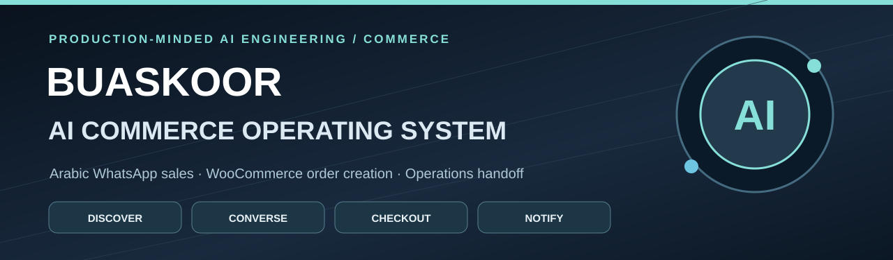

### Arabic-first AI sales, session management, WooCommerce integration and operational handoff

**Public, sanitized portfolio snapshot of a real-world commerce implementation.** Not a live customer account, not a turnkey deployment.

[**Customer journey**](#customer-journey) · [**Engineering decisions**](#engineering-highlights) · [**Source workflows**](#included-workflows) · [**Portfolio**](https://github.com/Badrna3om)

</div>

## Quick animated overview

<div align="center">

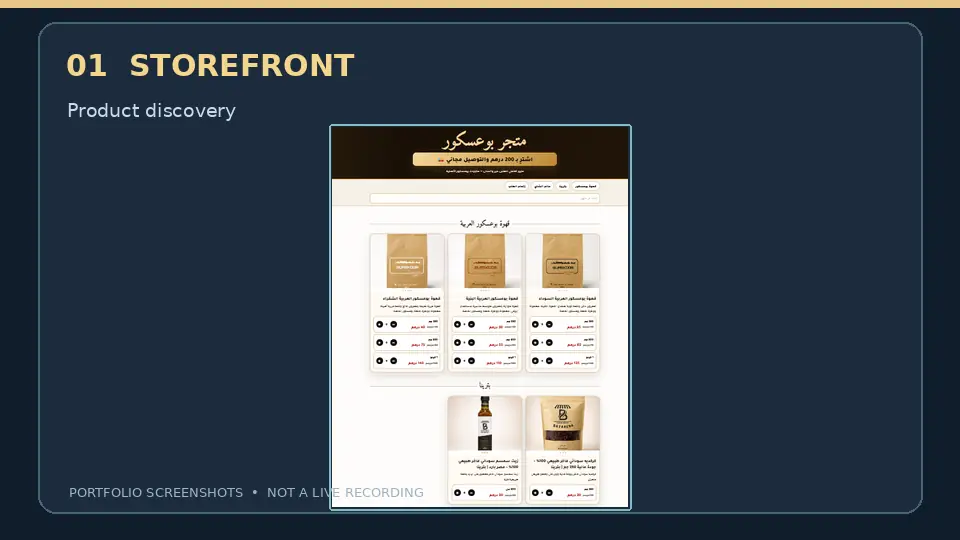

*Short sequence of existing public screenshots. This is an edited portfolio walkthrough, **not** a live system capture or a production-performance metric.*

</div>

## See the system in action

<table>
<tr>
<td align="center" width="33%">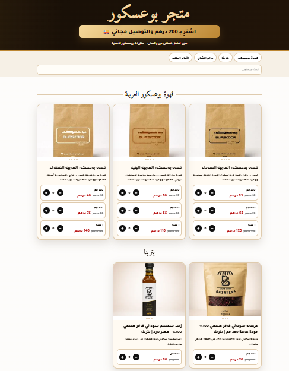<br/><b>01 · Explore the catalog</b></td>
<td align="center" width="33%">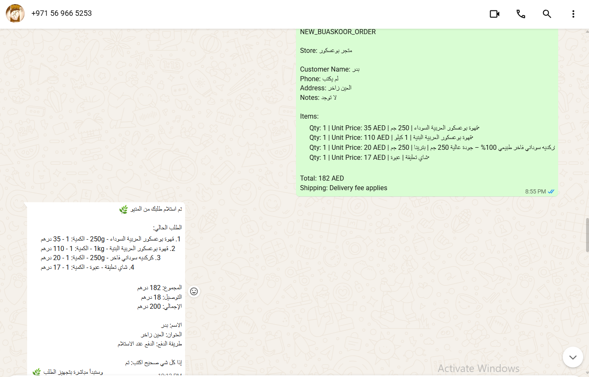<br/><b>02 · Conversational ordering</b></td>
<td align="center" width="33%">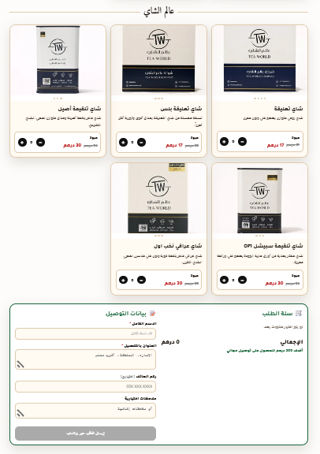<br/><b>03 · Order confirmation</b></td>
</tr>
</table>

*These are existing portfolio screenshots. They demonstrate interfaces and workflow stages; they do not provide independently verified sales, conversion rates, or time-saved metrics.*

### Customer-to-operations handoff

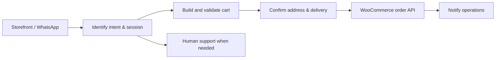

**Engineering proof:** three public sanitized n8n workflow exports; a product/menu storefront; explicit message deduplication, state handling, product/variation mapping and notification logic.

**Review the actual assets:** [Sales agent workflow](images/ai-agent-workflow.png) · [WooCommerce order creation](images/woocommerce-order-workflow.png) · [Operations notification](images/telegram-notification-workflow.png).

---

## Portfolio quick view

**BUASKOOR · Conversational Commerce**  
[Store preview](images/store-home.png) · [Customer journey](images/customer-whatsapp.png)

**What this proves:** customer-intent handling, cart/session state, commerce API integration and reliable order handoff.

> **Disclosure:** The repository is for public technical review. Operating credentials, private infrastructure, customer data and confidential business logic are excluded.

---

## Overview

This project demonstrates an AI-assisted commerce system developed for Buaskoor, a UAE-based coffee and specialty products store.

The platform connects an interactive product menu, a WhatsApp AI sales assistant, customer session management, WooCommerce order creation, and operational notifications.

> This repository contains a sanitized public portfolio version. Credentials, customer data, private infrastructure identifiers, and production secrets have been removed.

## Business Problem

Conversational commerce becomes difficult to scale when product questions, cart changes, delivery rules, customer details, and order creation are handled manually across WhatsApp and an online store. The result is repetitive work, inconsistent responses, and avoidable order-entry errors.

## Solution and Business Value

This platform turns WhatsApp conversations into a structured commerce journey while keeping WooCommerce as the order system of record.

- Guides customers from product discovery to confirmation
- Applies product, pricing, delivery, and eligibility rules consistently
- Reduces repetitive sales and support responses
- Creates WooCommerce orders without duplicate manual entry
- Preserves session context across multi-step conversations
- Escalates customers to a human when required
- Notifies operations automatically after order creation


---

## Main Capabilities

| Area | Capability |
|---|---|
| Storefront | One-page interactive menu with WhatsApp ordering |
| AI sales | Arabic conversational sales assistant with product guidance |
| Product knowledge | Structured coffee, tea, hibiscus, and sesame oil catalog |
| Order parsing | Product, size, quantity, customer name, area, and address extraction |
| Cart management | Add, update, remove, and summarize cart items |
| Session management | Persistent customer journey and conversation context |
| Delivery rules | UAE shipping logic with special-area pricing |
| WooCommerce | Automated order creation through the REST API |
| Notifications | Telegram operations alerts for new orders |
| Support routing | Human handover and previous-order inquiries |
| Idempotency | Duplicate WhatsApp message detection |
| Country handling | UAE eligibility routing and unsupported-country responses |

---

## System Architecture

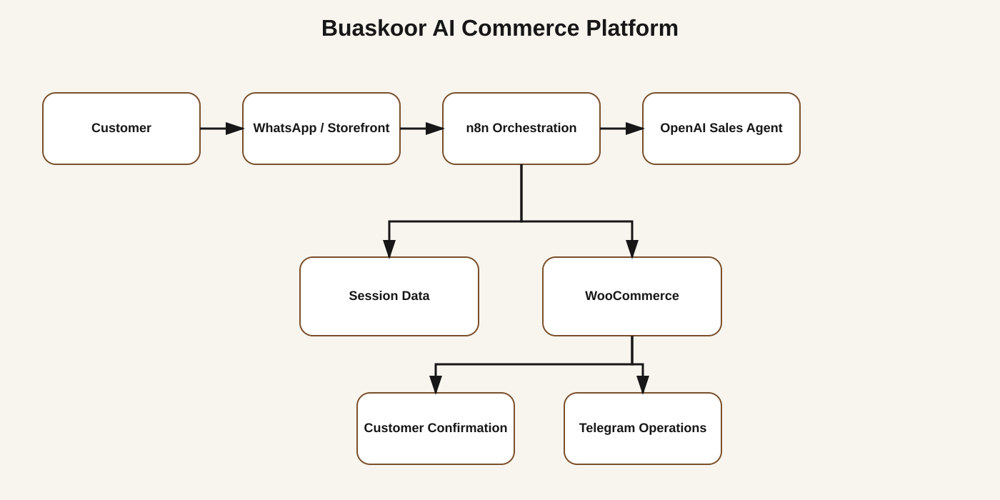

---

## Customer Journey

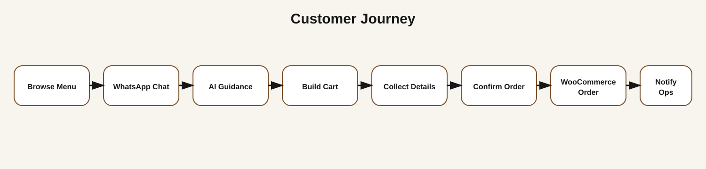

1. Customer opens the interactive product menu or starts a WhatsApp conversation.
2. The AI agent identifies intent and uses the product knowledge base.
3. The workflow stores session state and cart data.
4. Missing details are requested one step at a time.
5. Customer confirms the order.
6. n8n builds a WooCommerce order payload.
7. WooCommerce creates the order.
8. The customer receives confirmation.
9. The operations team receives a Telegram notification.

---

## Engineering Highlights

- Arabic-first conversational flow with structured intent and order extraction
- Persistent session and cart state across multiple customer messages
- Product and variation mapping before WooCommerce order creation
- Duplicate-message protection for WhatsApp webhook retries
- Country, shipping, and special-area pricing rules
- Modular workflows for sales, order creation, and operations notifications
- Sanitized public exports with credentials and private identifiers removed

---

## Technology Stack


- **Automation:** n8n
- **AI:** OpenAI GPT models
- **Messaging:** WhatsApp through Evolution API
- **Commerce:** WordPress and WooCommerce REST API
- **Operations:** Telegram Bot API
- **Frontend:** HTML, CSS, JavaScript
- **Data:** n8n Data Tables and JSON session state
- **Integration:** Webhooks, REST APIs, workflow sub-processes

---

## Included Workflows

### AI Sales Agent

`workflows/buaskoor-ai-sales-agent-public.json`

Handles incoming WhatsApp messages, country routing, duplicate-message protection, session retrieval, human support, previous-order inquiries, AI product assistance, cart extraction, and order confirmation.

### WooCommerce Order Creation

`workflows/woocommerce-order-creation-public.json`

Handles product and variation mapping, shipping calculation, WooCommerce order payload generation, REST API order creation, customer confirmation, and session reset.

### WooCommerce Operations Notification

`workflows/woocommerce-order-notification-public.json`

Handles new-order triggers, order retrieval, customer and delivery formatting, and Telegram operations alerts.

---
# 📸 Screenshots

## 🏪 Store Front


---

## 🛒 Checkout Experience


---

## 🤖 AI Sales Agent Workflow

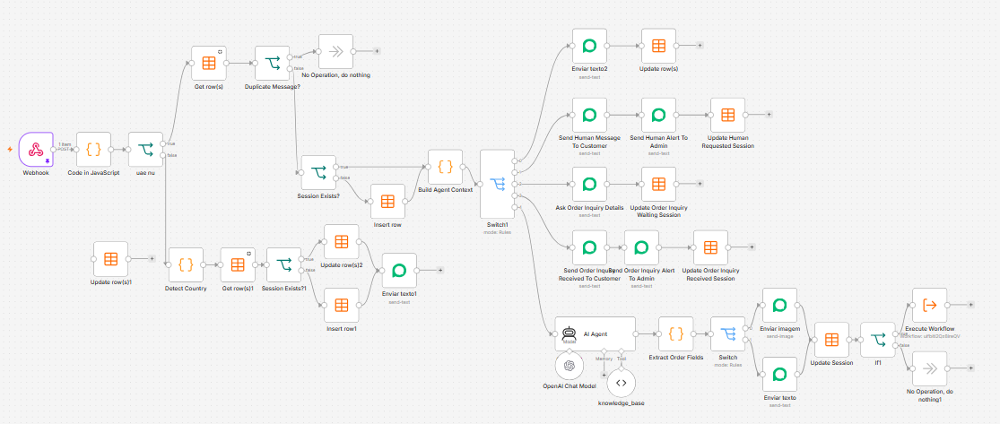

---

## 🛍️ WooCommerce Order Creation

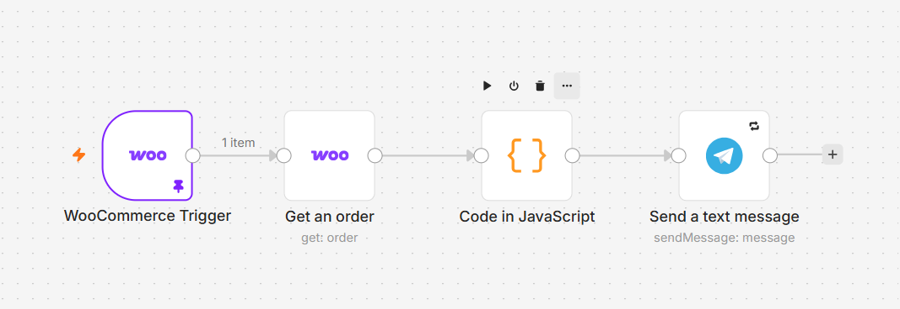

---

## 📩 Telegram Notification Workflow

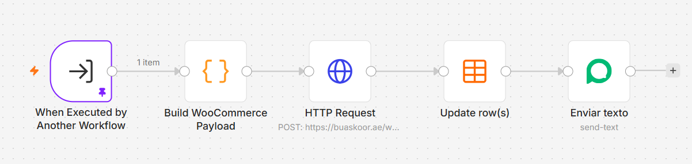

---

## 💬 Customer WhatsApp Journey

Customer receives automated order confirmation and completion messages.


---

## 🧑‍💼 Admin Order Notification

Automatic order notification sent to the store administrator.

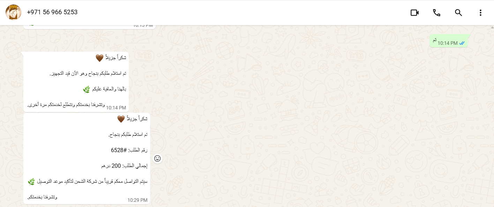

## Repository Structure

```text
Buaskoor-AI-Commerce-Platform/
├── README.md
├── NOTICE.md
├── .gitignore
├── docs/
├── images/
├── screenshots/
├── storefront/
└── workflows/
```

---

## Project Status

**Public portfolio snapshot of a real-world commerce implementation.**

The operating storefront and integrations are managed separately. These sanitized exports/screenshots are intended for engineering review, not direct production import. Any independent deployment needs protected credentials, authenticated interfaces, monitoring, backups and data-retention controls.

---

## Author

**Badreldin Mohamed Awad**  
AI Automation Engineer | E-Commerce Systems Specialist | n8n Workflow Architect  
Al Ain, UAE  
Email: [badrna3om@gmail.com](mailto:badrna3om@gmail.com)
