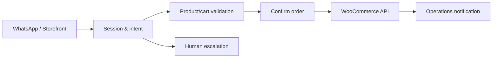

# BUASKOOR — AI Conversational Commerce Case Study

## Business objective

Build an Arabic-first buying journey in which product questions, cart changes, delivery eligibility, confirmation and order handoff can be coordinated across WhatsApp and WooCommerce.

## Public implementation

The repository contains **three sanitized workflow exports**: the sales agent (**38 nodes**), WooCommerce order creation (**5 nodes**) and operations notification (**4 nodes**). These counts were inspected from the committed public JSON exports on 26 Nov 2026; they are implementation inventory, not production volume.

| Journey stage | Artifact |
| --- | --- |
| Product exploration | [Storefront screenshot](../images/store-home.png) |
| Customer conversation | [WhatsApp conversation example](../images/customer-whatsapp.png) |
| AI conversation design | [Sales-agent workflow graph](../images/ai-agent-workflow.png) |
| Order confirmation | [Checkout screenshot](../images/checkout.png) |
| Order handoff | [WooCommerce order workflow](../images/woocommerce-order-workflow.png) |
| Operations | [Telegram notification workflow](../images/telegram-notification-workflow.png) |

## Engineering decisions

- Persist session and cart state across multi-step customer conversations.
- Handle Arabic product questions and route unsupported cases to human support.
- Reject duplicate WhatsApp inbound messages before replaying business steps.
- Resolve product/variation choices before calling the WooCommerce API.
- Keep delivery eligibility, special-area logic and order creation as deterministic workflow concerns.
- Notify business operations after the commerce handoff.

## Architecture

## What is and is not proven

The public workflow exports, storefront and screenshots are evidence of a functional integration design. They are **not** independently validated metrics for orders, revenue, conversion, savings or customer satisfaction.

## Deployment boundary

This is a sanitized public portfolio implementation. A new production environment requires credentials, webhook authenticity, role-based access, idempotency, reconciliation, observability, backup and data-retention review. See [Security](SECURITY.md) and [Setup](SETUP.md).

[Animated screenshots](../assets/visual-tour.webp) · [Public workflows](../workflows/) · [Storefront example](../storefront/)
